# SO-101 Suite

**Free, open source, for the SO-101 robot arm.** Clone it, run one command, and a web app walks you from an unopened box to a calibrated, working arm. It explains what every part and step is along the way.

`License: AGPL-3.0-or-later` · `Python 3.10 to 3.13 (uv installs it for you)` · `Works offline after install` · `No accounts, no telemetry`

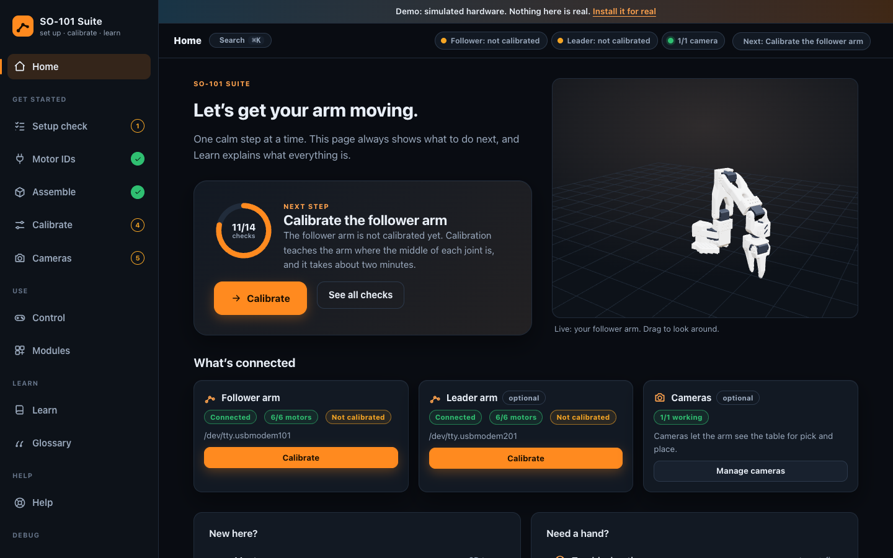

|  |  |  |
|---|---|---|
| 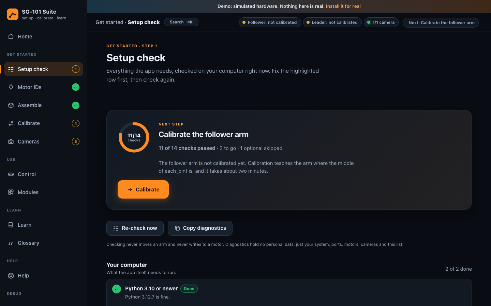 | 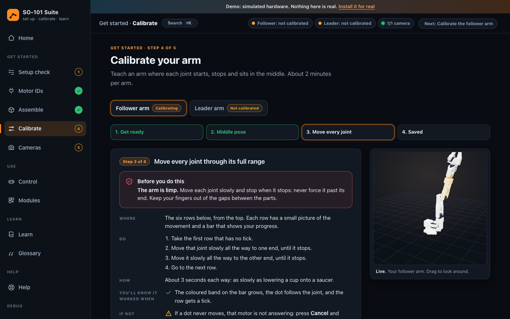 | 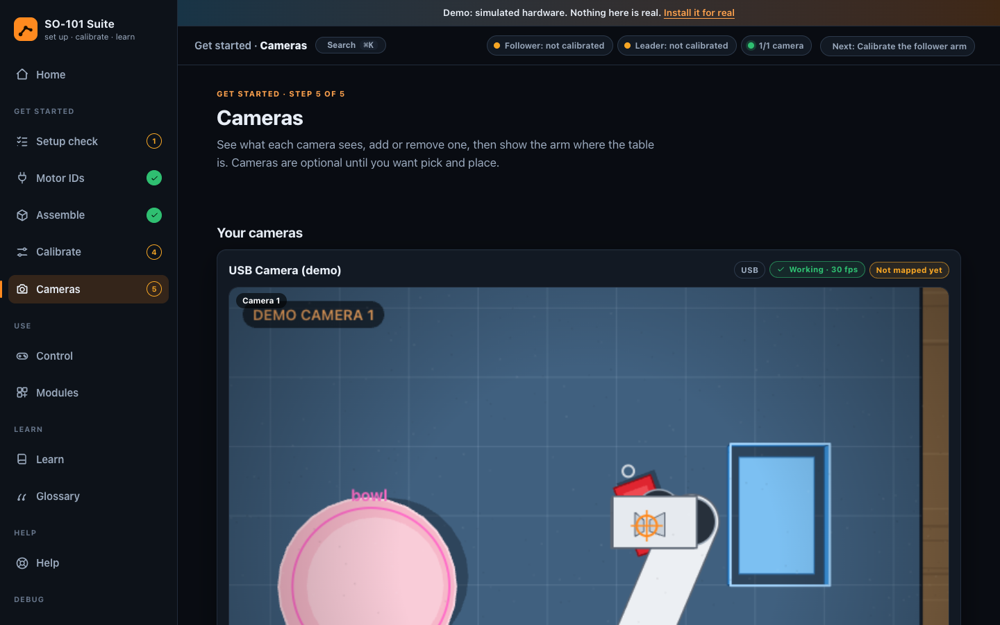 |
| 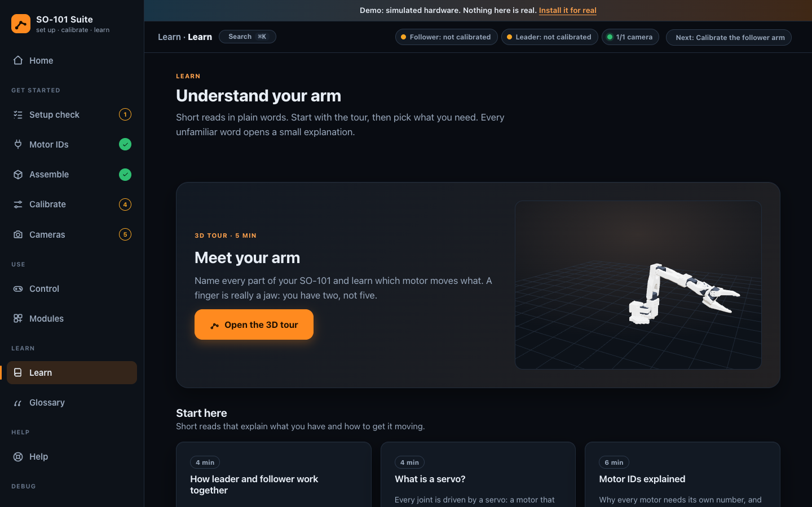 | 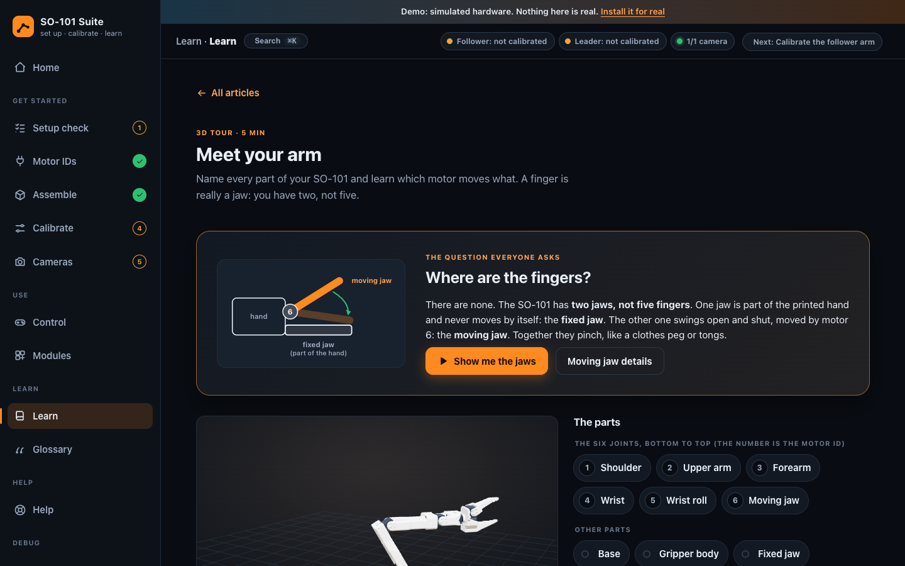 | 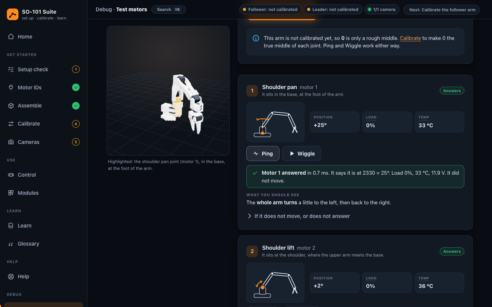 |
| 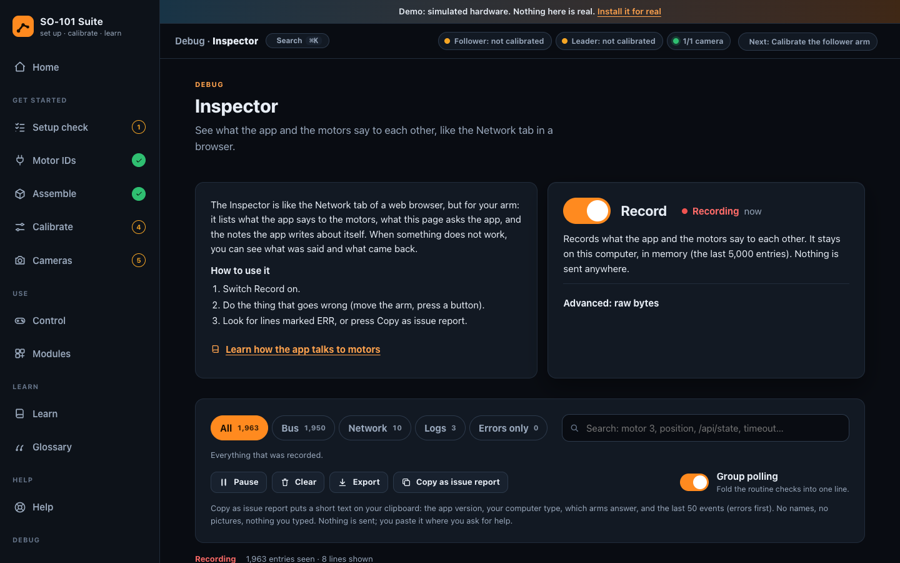 | 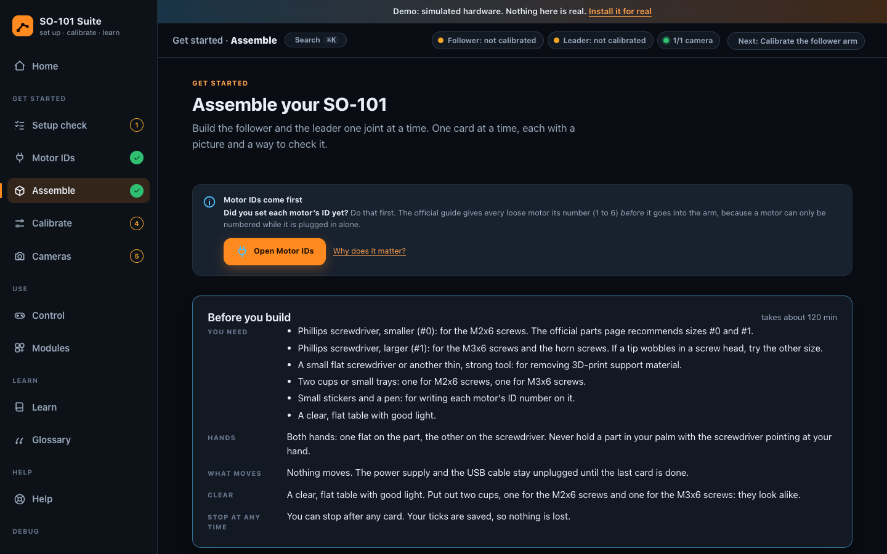 | 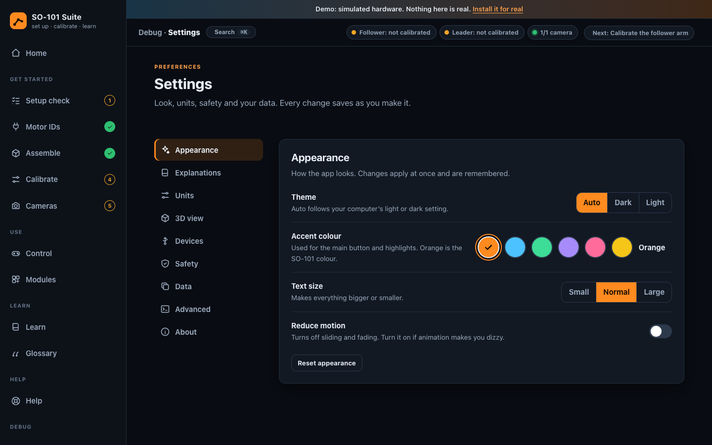 |

It also fits on a phone: 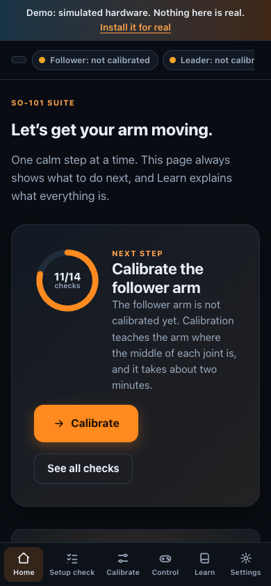

## Try it with no hardware: the live demo

You do not need an arm to look around.

- **In your browser:** see the website for the live demo (the page is called `/demo`). It is the same app, running against a simulated arm.
- **On your own computer:** after the [Quickstart](#quickstart) install, run `uv run so101 demo`. It starts the real app with simulated arms and cameras. No serial port or camera is ever opened.

## Quickstart

You need `git` and an internet connection for the install. You do not need Python: the setup script installs [uv](https://docs.astral.sh/uv/), and uv installs Python 3.12 and every package into the project folder (`./.venv`). No `sudo` for the normal path.

### macOS, Linux and Raspberry Pi

```bash
git clone https://github.com/Wendor-ai/so101-suite
cd so101-suite
./setup.sh
```

`./setup.sh` installs uv if it is missing, runs `uv sync`, then runs `uv run so101 setup`. That looks at your computer and at what is plugged in, then opens the app in your browser on the right page.

- **Linux and Raspberry Pi:** Linux must let your user open serial ports. If you are not in the `dialout` (or `uucp`) group, the script prints one command to run once, then log out and back in: `sudo usermod -aG dialout $USER`. If a USB camera is blocked, the Cameras page may ask for `sudo usermod -aG video $USER` the same way.
- **Raspberry Pi without a screen:** the addresses the app prints say `localhost`, which only works on the Pi itself. To open it from another computer on your network, start it with `uv run so101 start --host 0.0.0.0` (the app has no password, so only do this on a network you trust) and open `http://<the Pi's address>:8000`.
- **macOS:** the first time a camera is used, allow your terminal in System Settings, Privacy & Security, Camera.

### Windows (PowerShell)

Windows is **untested** so far. The macOS, Linux and Raspberry Pi path has been run on real hardware; the Windows script has not. If something fails, please open an issue and paste the output of `uv run so101 doctor`.

```powershell
git clone https://github.com/Wendor-ai/so101-suite
cd so101-suite
.\setup.ps1
```

If PowerShell refuses to run the file, run `Set-ExecutionPolicy -Scope CurrentUser RemoteSigned` once and try again. The arm's USB adapter may need the CH343 driver from its maker; the app's checklist says when the port is missing.

### Every day after that

```bash
uv run so101 start            # start the app (opens http://localhost:8000)
uv run so101 demo             # the same app with simulated hardware
uv run so101 doctor           # the checklist as text, to paste into a bug report
uv run so101 detect           # what this computer can see: OS, USB adapters, cameras
uv run so101 env              # which .env files were found and which settings they set (never the values)
```

`./setup.sh --no-start` installs without starting, and `./setup.sh --dry-run` shows what it would do without changing anything. Add `--port 8001` to `uv run so101 start` if port 8000 is taken, and `--host 0.0.0.0` to let other devices on your network open it, for example a Raspberry Pi screen (by default the app listens on this computer only, because it has no password).

## What you get

- **Auto-detect everything.** Your operating system, Raspberry Pi model, USB serial adapters, which adapter is which arm, the motors that answer on each bus (IDs 1 to 6), and USB or network cameras.
- **A live "what's connected" checklist** that always says the next thing to do, with a fix button on every item that is not done.
- **Guided motor IDs**, done before assembly like the official guide: plug in one loose motor at a time and give it its number.
- **An assembly guide:** parts, tools, one card per joint with a diagram, and links to the official videos.
- **Calibration where every joint reads 0 at the middle** of its range, shown in degrees or on LeRobot's -100 to +100 scale. It saves the same file LeRobot uses.
- **Cameras with click-to-calibrate:** add a USB or network camera, see why a picture is missing, then teach the camera where the table is by clicking on its picture.
- **Test motors:** ping each motor (never moves it) or wiggle it a little, and get a report per motor.
- **Inspector,** like a browser's Network tab for the arm: what the app and the motors say to each other, in words. Off until you switch it on.
- **A Learn section with a 3D arm** you can click, plus a glossary where every unfamiliar word has a plain explanation.
- **Modules:** drop a folder into `modules/` and the app finds it.
- **Demo mode,** so you can try everything, and test changes, with no hardware.
- **Command palette** (`Cmd+K` on macOS, `Ctrl+K` elsewhere) to jump to any page, article or term. Light and dark themes.

## First time? Here is what happens

1. **Setup check.** The app lists everything it needs, tells you what it can already see, and gives you a fix button for each missing item.
2. **Motor IDs.** Find your USB adapter by unplugging and replugging it, label it Leader or Follower, then set the ID of each loose motor, one at a time. A pre-built arm skips this: a scan that shows IDs 1 to 6 says so.
3. **Assemble.** Follow one card per joint and tick them off. Skip it if your arm is already built.
4. **Calibrate.** Centre the arm, move every joint through its full range, save. **The app asks you to calibrate the first time** it sees a connected arm that has no calibration: when an arm is connected, `./setup.sh` opens the calibration guide for you.
5. **Cameras.** Optional until you want pick and place. Add a camera, then click on its picture to map the table.

Then open **Control** for the 3D twin, leader to follower, and pick and place.

## For AI agents

This repo is set up for Claude Code, Codex, Cursor and similar tools.

- **[AGENTS.md](AGENTS.md)** is the place to start: commands, repo map, hard rules, how to test. `CLAUDE.md` points at it.
- **Skills** in [`.claude/skills/`](.claude/skills): `add-module`, `add-page`, `add-camera`, `calibrate-camera-by-clicking`, `calibrate-arm`, `debug-hardware`, `explain-for-beginners`, `run-demo-and-tests`, `write-physical-instructions`, `add-learn-article`. Cursor reads [`.cursor/rules/so101.mdc`](.cursor/rules/so101.mdc).
- **HTTP API:** everything the UI does is a plain web call, documented in [docs/API.md](docs/API.md). `GET /api/suite/snapshot/0.jpg` gives an agent a picture of the table, `GET /api/suite/checklist` says what is left.
- **No hardware needed:** `uv run so101 start --demo --no-browser --port 8150` starts the app with simulated arms for testing.
- **MCP server:** `uv run so101 mcp` lets Claude Code, Claude Desktop or Cursor look at a camera, read the checklist and the Inspector, and click-calibrate the camera mapping, using the running app. It is read-only by default; the tools that can move an arm need `--allow-motion`. Setup for each client: [docs/MCP.md](docs/MCP.md).
- **[llms.txt](llms.txt)** is a short plain-text overview for language models.

## Hardware and where to buy

This project is software only. For the parts, the 3D-printed files and the build instructions, use the official sources:

- SO-ARM100 and SO-101 hardware: <https://github.com/TheRobotStudio/SO-ARM100>
- LeRobot's SO-101 guide: <https://huggingface.co/docs/lerobot/so101>

See [docs/HARDWARE.md](docs/HARDWARE.md) for what the app expects (motor IDs, the USB adapter, power).

## Safety

A robot arm can pinch fingers and drop. These rules come from real runs ([docs/LEARNINGS.md](docs/LEARNINGS.md)).

- **The arm moves only when you ask.** The app says in a plain sentence what will move and asks you to confirm inside the page. Nothing starts on its own.
- **STOP appears whenever an arm has its motors on, and it holds the arm where it is.** **Release arm** lowers the arm onto the table and only then makes it limp, so nothing drops and nobody has to hold it. Cutting the power also makes it limp, and can drop a raised arm.
- **Every automatic move is guarded.** It stops and holds if a motor pushes at 70% of its torque or more (85% for wrist roll) for three readings in a row, or gets hot.
- **Stopping or restarting the app does not release the motors.** The arm keeps holding. The app reads the real state when it starts.
- **Pick and place never carries on after a failed grasp, keeps the gripper pointing straight down, and keeps clear of the bowl.** Demo mode never opens a real serial port.

Keep the base clamped to the table, keep hair and sleeves away, and do not leave a powered arm alone. The app's Learn section has a short safety checklist to run before every session.

## Optional: record, train and run policies with LeRobot

The Suite gets your arm built, calibrated and working. Recording demonstrations and training a policy is [LeRobot](https://github.com/huggingface/lerobot)'s job, and the project keeps a few helper scripts for it. They need LeRobot, which is a large download (it pulls in PyTorch):

```bash
uv sync --extra lerobot
cp .env.example .env               # your ports, IDs, camera and Hugging Face names (git-ignored, see docs/CONFIGURATION.md)
scripts/04_teleoperate.sh          # leader moves the follower
scripts/05_record.sh 20            # record 20 episodes (TASK="..." sets the task; needs a Hugging Face login)
scripts/06_train.sh                # train an ACT policy (uses mps on Apple Silicon; a CUDA GPU is better)
scripts/07_eval.sh                 # run the trained policy
```

`scripts/01_find_port.sh` to `scripts/03_calibrate.sh` do the same jobs as the app's Motor IDs and Calibrate pages with LeRobot's own command-line tools. Only one program can use a serial port at a time, so stop the app before running any of these.

## Project layout

```
setup.sh, setup.ps1     one-command install and first start
so101/                  the Python package: CLI, HTTP API, detection, checklist, modules, demo bus
app/server.py           the classic dashboard server (arms, cameras, pick and place, teleop)
app/suite/              the web app (plain HTML, CSS and ES modules, no build step)
app/pickplace.py, vision.py, kin.py    pick and place engine, vision, kinematics
app/vendor/, app/assets/               three.js and the SO-101 URDF and meshes
modules/                drop-in modules (start from modules/hello)
defaults/               factory defaults (so101.defaults.json)
tests/                  pytest (Python) and node:test (the in-browser mock)
site/                   the website and the no-install demo (Astro)
scripts/                helper scripts: LeRobot workflow, supervisor, Raspberry Pi kiosk
docs/                   ARCHITECTURE, API, MCP, MODULES, TROUBLESHOOTING, HARDWARE, DEFAULTS, CALIBRATION, FAQ, ROADMAP, LEARNINGS
examples/mcp/           ready-made MCP client configuration files
.claude/skills/, .cursor/rules/, AGENTS.md, CLAUDE.md, llms.txt    for AI agents
```

More: [Architecture](docs/ARCHITECTURE.md) · [API](docs/API.md) · [MCP](docs/MCP.md) · [Modules](docs/MODULES.md) · [Troubleshooting](docs/TROUBLESHOOTING.md) · [Calibration](docs/CALIBRATION.md) · [Defaults](docs/DEFAULTS.md) · [Configuration](docs/CONFIGURATION.md) · [FAQ](docs/FAQ.md) · [Roadmap](docs/ROADMAP.md)

## Contributing

Bug reports, hardware reports, new modules and Learn articles are welcome. Read [CONTRIBUTING.md](CONTRIBUTING.md); it is short. Be kind: [CODE_OF_CONDUCT.md](CODE_OF_CONDUCT.md). Security questions: [SECURITY.md](SECURITY.md).

## Not affiliated

SO-101 Suite is an independent community project. It is **not affiliated with, sponsored by or endorsed by** Hugging Face (LeRobot), The Robot Studio (SO-ARM100) or Feetech. Product and project names belong to their owners. See [NOTICE.md](NOTICE.md) for third-party software and its licences.

## Licence

[GNU Affero General Public License v3.0 or later](LICENSE). In plain words: you can use, change and share it for free, and if you share a modified version, including by running it as an online service, you share your changes under the same licence. That is a summary, not legal advice.
